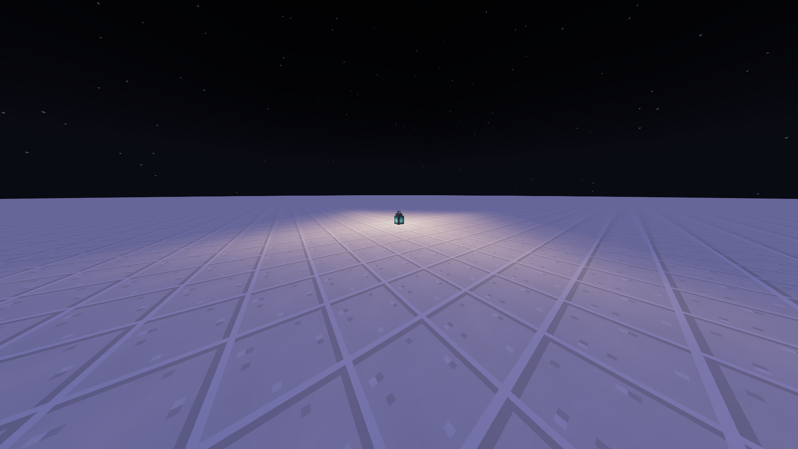
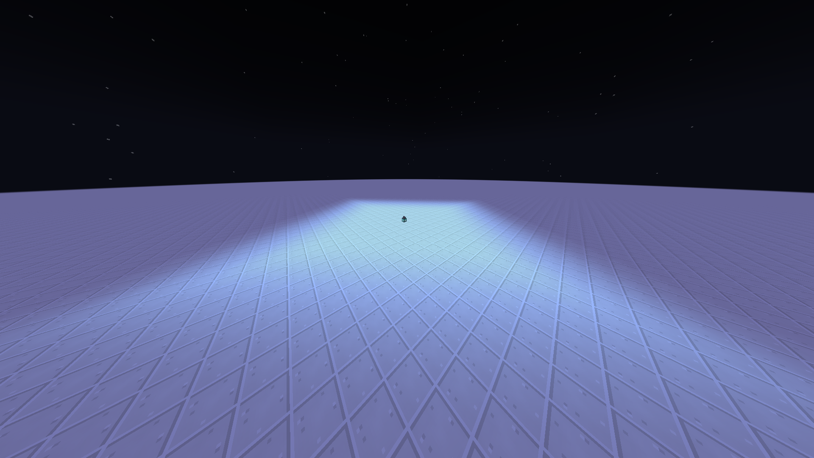

<p align="center">
  
</p>

<h1 align="center">Light Engine</h1>

<p align="center">
  <b>English</b> | <a href="README_ru.md">Русский</a>
</p>

<p align="center">
  
  
  
  
</p>

<p align="center"><i>Per-block light radius beyond 15 and true colored light, with an API for other mods.</i></p>

---

## What it does

- **Light radius up to 255.** Any block can shine further than the vanilla limit of 15. The radius is set per block.
- **True colored light.** Each light source gets its own color (`#RRGGBB`). The color fades smoothly across every face
  of every block, and the light of different sources blends together. Sky light and daylight are never tinted.
- **Works out of the box.** On first launch the "Radius and color" preset is written to the config:
  about 40 vanilla light sources get a longer radius and a fitting color.
- **In-game editor.** The lantern button in the pause menu opens the editor: a block list with icons, radius and color,
  and a live preview of the light. Changes on a server need operator rights.
- **Presets:** "Both" (radius and color), "Radius" only, "Color" only.
- **API for other mods:** give your blocks a radius and color in code, without code (IMC), or through a Fabric entrypoint.
- Vanilla lighting below level 15 is untouched. Extended light is saved with the world and synced to clients with chunks.

## Screenshots

### Vanilla

<p align="center"></p>

### Radius

| Light Engine (radius 30) | Light Engine (radius 60) |
| :---: | :---: |
|  |  |

### Color

| Colored light | Mixing sources |
| :---: | :---: |
|  |  |

## Compatibility

| Mod | Status |
| --- | --- |
| Sodium | ✅ Radius and color work |
| Iris (shader packs) | ⚠️ Compatible, the radius works, but the color is not visible while a shader pack is on |
| Other mods' light blocks | ✅ Any block can be set up in the editor or the config |

## Versions

The code for each version lives in its own branch:

| Minecraft | Fabric | NeoForge | Forge |
| --- | --- | --- | --- |
| 1.20.1 | [`fabric/1.20.1`](https://github.com/tewek444/Light-Engine/tree/fabric/1.20.1) | — | [`forge/1.20.1`](https://github.com/tewek444/Light-Engine/tree/forge/1.20.1) |
| 1.20.2 | [`fabric/1.20.2`](https://github.com/tewek444/Light-Engine/tree/fabric/1.20.2) | — | — |
| 1.20.3 – 1.20.4 | [`fabric/1.20.4`](https://github.com/tewek444/Light-Engine/tree/fabric/1.20.4) | — | — |
| 1.20.5 – 1.20.6 | [`fabric/1.20.6`](https://github.com/tewek444/Light-Engine/tree/fabric/1.20.6) | [`neoforge/1.20.6`](https://github.com/tewek444/Light-Engine/tree/neoforge/1.20.6) | — |
| 1.21 | [`fabric/1.21`](https://github.com/tewek444/Light-Engine/tree/fabric/1.21) | — | — |
| 1.21.1 | [`fabric/1.21.1`](https://github.com/tewek444/Light-Engine/tree/fabric/1.21.1) | [`neoforge/1.21.1`](https://github.com/tewek444/Light-Engine/tree/neoforge/1.21.1) | — |
| 1.21.2 – 1.21.3 | [`fabric/1.21.3`](https://github.com/tewek444/Light-Engine/tree/fabric/1.21.3) | [`neoforge/1.21.3`](https://github.com/tewek444/Light-Engine/tree/neoforge/1.21.3) | — |
| 1.21.4 | [`fabric/1.21.4`](https://github.com/tewek444/Light-Engine/tree/fabric/1.21.4) | [`neoforge/1.21.4`](https://github.com/tewek444/Light-Engine/tree/neoforge/1.21.4) | — |
| 1.21.5 | [`fabric/1.21.5`](https://github.com/tewek444/Light-Engine/tree/fabric/1.21.5) | [`neoforge/1.21.5`](https://github.com/tewek444/Light-Engine/tree/neoforge/1.21.5) | — |
| 1.21.6 | [`fabric/1.21.6`](https://github.com/tewek444/Light-Engine/tree/fabric/1.21.6) | — | — |
| 1.21.7 – 1.21.8 | [`fabric/1.21.8`](https://github.com/tewek444/Light-Engine/tree/fabric/1.21.8) | [`neoforge/1.21.8`](https://github.com/tewek444/Light-Engine/tree/neoforge/1.21.8) (1.21.8) | — |
| 1.21.9 – 1.21.10 | [`fabric/1.21.10`](https://github.com/tewek444/Light-Engine/tree/fabric/1.21.10) | [`neoforge/1.21.10`](https://github.com/tewek444/Light-Engine/tree/neoforge/1.21.10) | — |
| 1.21.11 | [`fabric/1.21.11`](https://github.com/tewek444/Light-Engine/tree/fabric/1.21.11) | [`neoforge/1.21.11`](https://github.com/tewek444/Light-Engine/tree/neoforge/1.21.11) | — |
| 26.1 – 26.1.2 | [`fabric/26.1`](https://github.com/tewek444/Light-Engine/tree/fabric/26.1) | [`neoforge/26.1`](https://github.com/tewek444/Light-Engine/tree/neoforge/26.1) | — |
| 26.2 | [`fabric/26.2`](https://github.com/tewek444/Light-Engine/tree/fabric/26.2) | [`neoforge/26.2`](https://github.com/tewek444/Light-Engine/tree/neoforge/26.2) | — |
| 26.3 | [`fabric/26.3`](https://github.com/tewek444/Light-Engine/tree/fabric/26.3) | [`neoforge/26.3`](https://github.com/tewek444/Light-Engine/tree/neoforge/26.3) | — |

Fabric needs [Fabric API](https://modrinth.com/mod/fabric-api).

## Config

Everything is stored in `config/lightengine-common.toml`. The editor writes to the same file, and changes are picked up
without restarting. One block looks like this:

```toml
["minecraft:soul_lantern"]
	light_radius = 20
	light_color_enabled = true
	ignore_conditions = false
	light_color = "#77CFFF"
```

- `light_radius`: 0–255.
- `light_color`: `#RRGGBB`. `light_color_enabled = false` keeps the vanilla color.
- `ignore_conditions`: the block shines even when it is "off" (`lit=false` / `powered=false`).

## Commands

All commands live under `/le` (or the long form `/light_engine`):

| Command | Who | What it does |
| --- | --- | --- |
| `/le light_level` | anyone | Toggles the light level overlay (numbers on block faces, extended levels shown as-is) |
| `/le update_check` | anyone | Checks GitHub for a newer version of this build |
| `/le repair [pos] [radius]` | operator | Re-checks stale extended light around a position (radius 8–64, default 40) |
| `/le dump <x> <y> <z>` | operator | Writes the extended light around a position to chat and the log (debugging) |
| `/le dump_client` | anyone | Same, from the client's copy of the light (debugging) |

## For mod developers

Call from common setup on both sides, so the client and the server agree:

```java
// radius 24, cyan light
LightEngineApi.registerLight(MyBlocks.CRYSTAL_LAMP.get(), 24, 0x77CFFF);
// keep the vanilla radius, only add a color
LightEngineApi.registerColor(MyBlocks.RUBY_TORCH.get(), 0xFF3030);
// color per block state; -1 = vanilla light
LightEngineApi.registerColorProvider(MyBlocks.RGB_LAMP.get(), state -> state.getValue(COLOR).rgb());
```

**Without a compile dependency (NeoForge / Forge, IMC)**, during `InterModEnqueueEvent`:

```java
InterModComms.sendTo("lightengine", "register_light", () -> Map.of(
        "block", "mymod:crystal_lamp", "radius", 24, "color", "#77CFFF"));
```

Keys: `block` (required), `radius` (0–255), `color` (`"#RRGGBB"` or int), `ignore_conditions` (boolean).

**Fabric entrypoint:** declare `"entrypoints": { "lightengine": ["com.example.MyLights"] }` in `fabric.mod.json`
and implement `LightEngineEntrypoint`.

Reading light: `LightEngineApi.getLightLevel(level, pos)` (0–255), `getLightColor(level, pos)`, `getEmitterColor(state)`.

User settings from the config and the editor always take priority over what a mod registered.

## License

MIT — forks allowed as long as the copyright notice (`Copyright (c) 2026 Tewek`) and this permission notice stay included.
