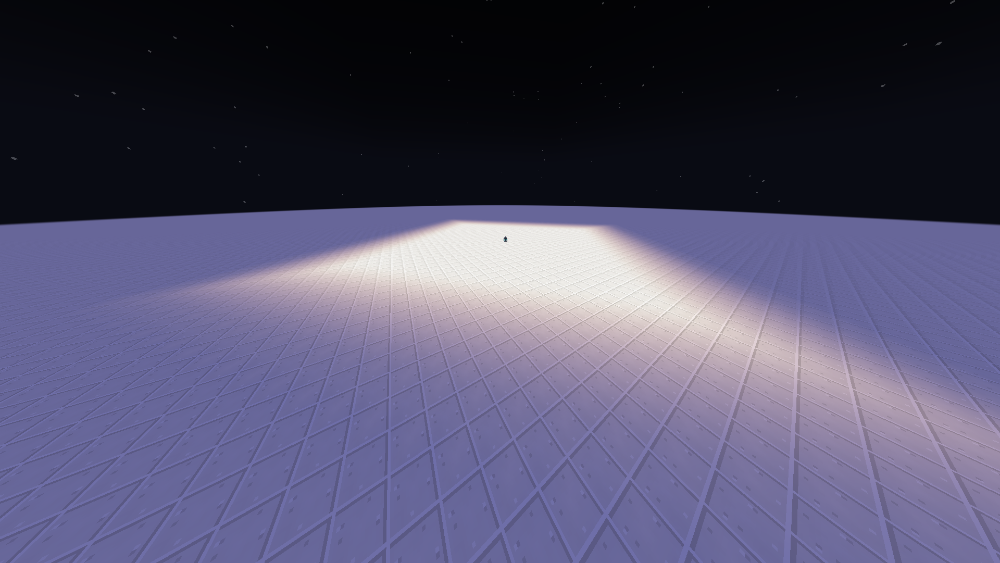
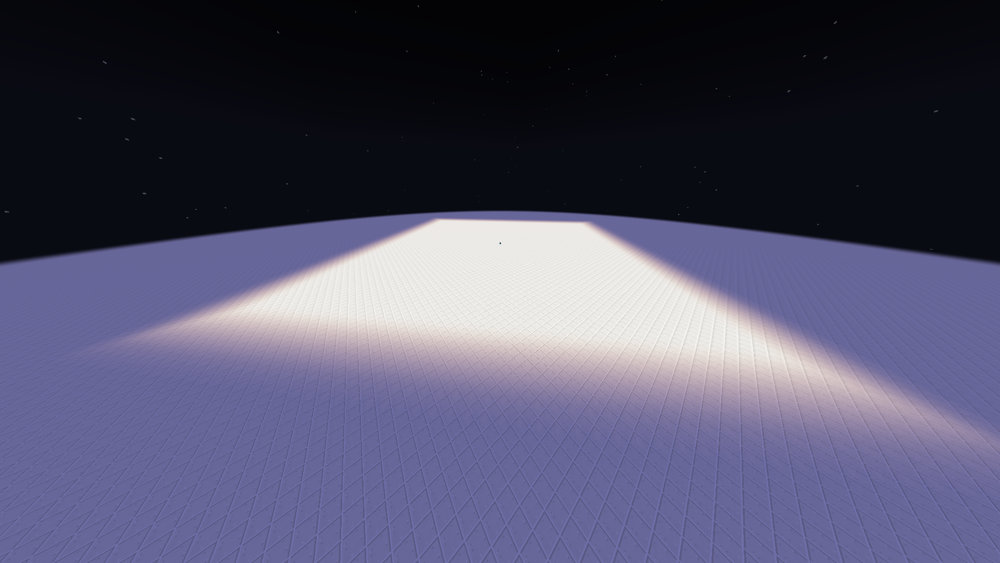
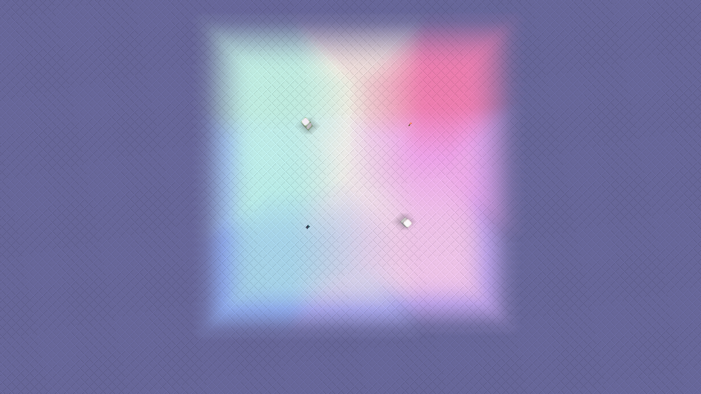

<p align="center">
  
</p>

<h1 align="center">Light Engine</h1>

<p align="center">
  <a href="README.md">English</a> | <b>Русский</b>
</p>

<p align="center">
  
  
  
  
</p>

<p align="center"><i>Радиус света больше 15 для любого блока и настоящий цветной свет, с API для других модов.</i></p>

---

## Что делает мод

- **Радиус света до 255.** Любой блок может светить дальше ванильного предела в 15. Радиус задаётся для каждого блока.
- **Настоящий цветной свет.** У каждого источника свой цвет (`#RRGGBB`). Цвет плавно растекается по каждой грани
  каждого блока, свет разных источников смешивается. Свет неба и дневной свет не окрашиваются.
- **Работает сразу после установки.** При первом запуске в конфиг записывается пресет «Радиус и цвет»:
  около 40 ванильных источников получают увеличенный радиус и подходящий цвет.
- **Редактор в игре.** Кнопка-фонарь в меню паузы открывает редактор: список блоков с иконками, радиус, цвет
  и живое превью света. На сервере для изменений нужны права оператора.
- **Пресеты:** «Оба» (радиус и цвет), только «Радиус», только «Цвет».
- **API для других модов:** радиус и цвет для своих блоков из кода, без зависимости (IMC) или через entrypoint на Fabric.
- Ванильное освещение до уровня 15 не меняется. Расширенный свет сохраняется вместе с миром и передаётся клиентам с чанками.

## Скриншоты

### Радиус

| Ваниль (радиус 15) | Light Engine (радиус 30) | Light Engine (радиус 60) |
| :---: | :---: | :---: |
| <!--  --> *скриншот* | <!--  --> *скриншот* | <!--  --> *скриншот* |

### Цвет

| Ваниль | Цветной свет | Смешение источников |
| :---: | :---: | :---: |
| <!--  --> *скриншот* | <!--  --> *скриншот* | <!--  --> *скриншот* |

## Совместимость

| Мод | Статус |
| --- | --- |
| Sodium | ✅ Радиус и цвет работают |
| Iris (шейдеры) | ⚠️ Совместимо, радиус работает, но цвет не виден, пока включён шейдерпак |
| Светящиеся блоки других модов | ✅ Любой блок настраивается в редакторе или в конфиге |

## Версии

Код каждой версии лежит в своей ветке:

| Minecraft | Fabric | NeoForge | Forge |
| --- | --- | --- | --- |
| 1.20.1 | [`fabric/1.20.1`](https://github.com/tewek444/Light-Engine/tree/fabric/1.20.1) | — | [`forge/1.20.1`](https://github.com/tewek444/Light-Engine/tree/forge/1.20.1) |
| 1.20.2 | [`fabric/1.20.2`](https://github.com/tewek444/Light-Engine/tree/fabric/1.20.2) | — | — |
| 1.20.3 – 1.20.4 | [`fabric/1.20.4`](https://github.com/tewek444/Light-Engine/tree/fabric/1.20.4) | — | — |
| 1.20.5 – 1.20.6 | [`fabric/1.20.6`](https://github.com/tewek444/Light-Engine/tree/fabric/1.20.6) | [`neoforge/1.20.6`](https://github.com/tewek444/Light-Engine/tree/neoforge/1.20.6) | — |
| 1.21 | [`fabric/1.21`](https://github.com/tewek444/Light-Engine/tree/fabric/1.21) | — | — |
| 1.21.1 | [`fabric/1.21.1`](https://github.com/tewek444/Light-Engine/tree/fabric/1.21.1) | [`neoforge/1.21.1`](https://github.com/tewek444/Light-Engine/tree/neoforge/1.21.1) | — |
| 1.21.2 – 1.21.3 | [`fabric/1.21.3`](https://github.com/tewek444/Light-Engine/tree/fabric/1.21.3) | [`neoforge/1.21.3`](https://github.com/tewek444/Light-Engine/tree/neoforge/1.21.3) | — |
| 1.21.4 | [`fabric/1.21.4`](https://github.com/tewek444/Light-Engine/tree/fabric/1.21.4) | [`neoforge/1.21.4`](https://github.com/tewek444/Light-Engine/tree/neoforge/1.21.4) | — |
| 1.21.5 | [`fabric/1.21.5`](https://github.com/tewek444/Light-Engine/tree/fabric/1.21.5) | [`neoforge/1.21.5`](https://github.com/tewek444/Light-Engine/tree/neoforge/1.21.5) | — |
| 1.21.6 | [`fabric/1.21.6`](https://github.com/tewek444/Light-Engine/tree/fabric/1.21.6) | — | — |
| 1.21.7 – 1.21.8 | [`fabric/1.21.8`](https://github.com/tewek444/Light-Engine/tree/fabric/1.21.8) | [`neoforge/1.21.8`](https://github.com/tewek444/Light-Engine/tree/neoforge/1.21.8) (1.21.8) | — |
| 1.21.9 – 1.21.10 | [`fabric/1.21.10`](https://github.com/tewek444/Light-Engine/tree/fabric/1.21.10) | [`neoforge/1.21.10`](https://github.com/tewek444/Light-Engine/tree/neoforge/1.21.10) | — |
| 1.21.11 | [`fabric/1.21.11`](https://github.com/tewek444/Light-Engine/tree/fabric/1.21.11) | [`neoforge/1.21.11`](https://github.com/tewek444/Light-Engine/tree/neoforge/1.21.11) | — |
| 26.1 – 26.1.2 | [`fabric/26.1`](https://github.com/tewek444/Light-Engine/tree/fabric/26.1) | [`neoforge/26.1`](https://github.com/tewek444/Light-Engine/tree/neoforge/26.1) | — |
| 26.2 | [`fabric/26.2`](https://github.com/tewek444/Light-Engine/tree/fabric/26.2) | [`neoforge/26.2`](https://github.com/tewek444/Light-Engine/tree/neoforge/26.2) | — |
| 26.3 | [`fabric/26.3`](https://github.com/tewek444/Light-Engine/tree/fabric/26.3) | [`neoforge/26.3`](https://github.com/tewek444/Light-Engine/tree/neoforge/26.3) | — |

Для Fabric нужен [Fabric API](https://modrinth.com/mod/fabric-api).

## Конфиг

Всё хранится в `config/lightengine-common.toml`. Редактор пишет в тот же файл, изменения подхватываются
без перезапуска. Один блок выглядит так:

```toml
["minecraft:soul_lantern"]
	light_radius = 20
	light_color_enabled = true
	ignore_conditions = false
	light_color = "#77CFFF"
```

- `light_radius`: 0–255.
- `light_color`: `#RRGGBB`. При `light_color_enabled = false` остаётся ванильный цвет.
- `ignore_conditions`: блок светит, даже когда он «выключен» (`lit=false` / `powered=false`).

## Команды

Все команды начинаются с `/le` (или полностью `/light_engine`):

| Команда | Кто может | Что делает |
| --- | --- | --- |
| `/le light_level` | все | Включает и выключает оверлей уровня света (числа на гранях блоков, уровни выше 15 видны как есть) |
| `/le update_check` | все | Проверяет на GitHub, нет ли новой версии для этой сборки |
| `/le repair [pos] [radius]` | оператор | Перепроверяет «зависший» расширенный свет вокруг точки (радиус 8–64, по умолчанию 40) |
| `/le dump <x> <y> <z>` | оператор | Выводит расширенный свет вокруг точки в чат и лог (для отладки) |
| `/le dump_client` | все | То же, но по копии света на клиенте (для отладки) |

## Для разработчиков модов

Вызывайте в common setup на обеих сторонах, чтобы клиент и сервер совпадали:

```java
// радиус 24, голубой свет
LightEngineApi.registerLight(MyBlocks.CRYSTAL_LAMP.get(), 24, 0x77CFFF);
// ванильный радиус, только цвет
LightEngineApi.registerColor(MyBlocks.RUBY_TORCH.get(), 0xFF3030);
// цвет по состоянию блока; -1 = ванильный свет
LightEngineApi.registerColorProvider(MyBlocks.RGB_LAMP.get(), state -> state.getValue(COLOR).rgb());
```

**Без зависимости при компиляции (NeoForge / Forge, IMC)**, в `InterModEnqueueEvent`:

```java
InterModComms.sendTo("lightengine", "register_light", () -> Map.of(
        "block", "mymod:crystal_lamp", "radius", 24, "color", "#77CFFF"));
```

Ключи: `block` (обязательно), `radius` (0–255), `color` (`"#RRGGBB"` или число), `ignore_conditions` (boolean).

**Entrypoint на Fabric:** объявите `"entrypoints": { "lightengine": ["com.example.MyLights"] }` в `fabric.mod.json`
и реализуйте `LightEngineEntrypoint`.

Чтение света: `LightEngineApi.getLightLevel(level, pos)` (0–255), `getLightColor(level, pos)`, `getEmitterColor(state)`.

Настройки пользователя из конфига и редактора всегда важнее того, что зарегистрировал мод.

## Лицензия

MIT — форки разрешены, пока сохранены копирайт (`Copyright (c) 2026 Tewek`) и текст лицензии.
